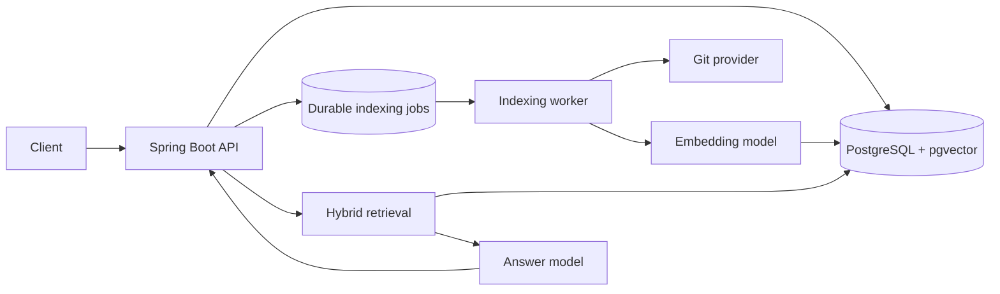

# Codebase Copilot

An AI-assisted codebase analyst API. Connect a Git repository, index its source in the background, then ask architecture and code-flow questions with answers grounded in file and line citations.

## Product scope

The first release will support:

1. Registering a repository as a project.
2. Requesting an index and tracking its status without waiting for the clone/index operation in the HTTP request.
3. Parsing and chunking source files while retaining revision, path, and line ranges.
4. Asking questions with retrieval-grounded answers and citations.
5. Re-indexing a branch as a new revision and deleting a project with its derived data.

## Architecture choices

- **Modular monolith first:** one Spring Boot deployable, with project, indexing, retrieval, and answer modules separated by package/API boundaries. This keeps local development and transactions simple. The indexing worker can become a separate deployment when its resource profile or scaling needs diverge.
- **PostgreSQL + pgvector:** relational data and embeddings share a transactional store initially. A repository can later move to a dedicated vector/search service if measured query volume or corpus size requires it.
- **Asynchronous indexing:** API requests create durable jobs and return quickly. Workers claim jobs from PostgreSQL; a broker can replace the job table if throughput or fan-out justifies it.
- **Retrieval before generation:** only the highest-ranked code chunks are sent to the model. Answers return citations, model name, and token usage; unsupported citation numbers are rejected.
- **Resilience and operations:** health probes, graceful shutdown, externalized configuration, migration-managed schema, and observable job states are part of the baseline.
- **Security before public deployment:** add identity, tenant scoping, repository credential handling, quotas, and secret redaction before exposing private repository ingestion publicly.



## Local development

Requirements: Java 21, Maven 3.6.3+, and Docker Compose. AI runs locally through Ollama; no OpenAI key or paid model API is needed. Ollama downloads the model files to a persistent Docker volume, so allow disk space and RAM for them.

```bash
docker compose up --build -d
docker compose exec -T ollama ollama pull qwen2.5-coder:1.5b
docker compose exec -T ollama ollama pull nomic-embed-text
```

Wait for both model downloads before requesting a new index job. The local chat model answers questions; the embedding model supports semantic retrieval. The first chat request can take a few minutes while the model loads on CPU, so Compose allows a five-minute AI response timeout. Answers are capped at 512 generated tokens to keep local CPU responses bounded. The migration to 768-dimensional local embeddings clears old vectors, so re-index repositories once after upgrading. Existing source chunks remain available for text search until re-indexing completes.

Health endpoint: `GET http://localhost:8080/actuator/health`

Open `http://localhost:8080` for the web interface. It lets you register a public GitHub repository, queue indexing, track the background job, ask codebase questions, and inspect source citations. The UI is served by Spring Boot itself, so the browser uses the same origin as the API and no separate frontend server or CORS setup is needed.

Example flow:

```powershell
$project = Invoke-RestMethod -Method Post http://localhost:8080/api/v1/projects `
  -ContentType 'application/json' `
  -Body '{"name":"Spring Petclinic","repositoryUrl":"https://github.com/spring-projects/spring-petclinic","defaultBranch":"main"}'

$job = Invoke-RestMethod -Method Post "http://localhost:8080/api/v1/projects/$($project.id)/index-jobs"
do {
  Start-Sleep -Seconds 2
  $status = Invoke-RestMethod "http://localhost:8080/api/v1/index-jobs/$($job.id)"
} while ($status.status -in @('QUEUED', 'RUNNING'))
$status

Invoke-RestMethod -Method Post "http://localhost:8080/api/v1/projects/$($project.id)/questions" `
  -ContentType 'application/json' -Body '{"question":"Where is the application entry point?"}'
```

Initial API surface:

- `POST /api/v1/projects` registers a repository URL and returns `201 Created`.
- `GET /api/v1/projects?page=0&size=20` lists registered projects (maximum page size 100).
- `DELETE /api/v1/projects/{projectId}` deletes a project and its jobs and indexed chunks.
- `POST /api/v1/projects/{projectId}/index-jobs` requests indexing and returns `202 Accepted` with a job resource location.
- `GET /api/v1/index-jobs/{jobId}` returns the durable job state; `GET /api/v1/projects/{projectId}/index-jobs` lists its jobs.
- `POST /api/v1/projects/{projectId}/questions` answers a question with code citations after indexing completes.
- Duplicate repository registrations return `409 Conflict`; invalid fields return `400 Bad Request` with a stable error shape.
- `GET /actuator/health` reports application and database health.

The database enforces one active indexing job per project. Concurrent requests converge on the active job, which avoids duplicate expensive work. The worker uses an atomic PostgreSQL `SKIP LOCKED` claim and renewable lease so crashed jobs can be reclaimed. Public GitHub repositories are shallow-cloned and indexed under file and size caps. Each revision is published only after all of its chunks are written, so partially indexed revisions are not served to question requests. The worker can be disabled in API replicas with `INDEXING_WORKER_ENABLED=false` and run in separate worker replicas using the same image and database.

PostgreSQL defaults are for local development only. Set `DB_URL`, `DB_USERNAME`, and `DB_PASSWORD` for another environment. AI settings are configurable through `AI_ENABLED`, `AI_BASE_URL`, `AI_CHAT_MODEL`, and `AI_EMBEDDING_MODEL`. In the Compose setup, repository snippets are sent only to the local Ollama service for embeddings and answers. The current vector schema expects 768-dimensional embeddings; changing embedding dimensions requires a schema migration and re-indexing.

## Current boundary

This version supports public GitHub repositories and is intended for local portfolio use. Authentication, private repository access, per-user authorization, and quotas are not implemented yet. The API is bound to localhost in Compose; add those controls before exposing it to other users.

Be ready to explain why the API does not clone a repository inline, why every chunk keeps a commit and line range, how duplicate job delivery is made safe, how model timeouts and rate limits are handled, how tenant isolation works, and what metrics would trigger a worker/broker split. The architecture should be scaled from measured bottlenecks rather than by adding microservices on day one.

## Roadmap

- [x] Project registration API with bounded pagination and consistent error responses
- [x] Durable indexing job API, active-job de-duplication, and atomic worker lease claim
- [x] Public GitHub shallow clone, file filters, and bounded indexing
- [x] Revision-aware code chunks, embeddings, full-text and vector retrieval
- [x] Grounded answer API with citations
- [ ] Incremental diff-based indexing between commits
- [ ] GitHub OAuth for private repository access and per-user ownership
- [ ] Authentication, tenant isolation, quotas, and audit trail
- [ ] Evaluation set, tracing, dashboards, and load testing
